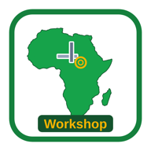

# SAME LOOK FIX (v2): the standard look is now PURCHASES (pa-v85)
Do not publish without Johan's OK and one screenshot. No spending.

Check yourself:
1. `python3 /workspace/tmc-base/tools/same_look.py <your app folder>` must say `SAME LOOK: OK (16/16)`.
2. Then `python3 /workspace/tmc-base/tests/run_all.py <your app folder>` must pass.

Reference: /workspace/tmc-base/index.html (VER 4, Purchases look). Pictures: /workspace/look_compare2.png (sign-in) and /workspace/home_compare.png (home).
Keep your own APP_ID, CACHE_PREFIX, storage, Sheet, sync script and all your features. Never mix data.
**Colour is your own app setting** (CONFIG `COLOR` / `COLOR_DARK`). It is not checked. Fuel keeps orange.

## The Purchases look, in short
- **Sign-in:** coloured gradient page, white card (radius 14px), logo, app name, then a 🌐 language dropdown, then name, then Continue.
- **Pages:** grey page background #f1f5f9, font system-ui, sticky coloured header.
- **Home:** white hero card (logo, name, date), then a "👋 Hi, name" card, then a 2-column grid of big white tiles with a green border (big icon, one word, count).
- **Menu:** bottom bar `<nav class="tabs">`. Each button holds `<span class="ticon">icon</span><span class="tlab">one word</span>`, at most 5 items, and the current one has a coloured top line.
- **Banners:** red "Not connected" (`#ncW`) and an amber update banner (`#updW` or `#updBar`).
- **Sync:** v4 token, no code (register, login, setpin, `<APP_ID>_tok`). Spellcheck on text boxes.
- **Rule 1 (staff with little schooling):** every button and field at least 56px tall (base uses 58px, menu 64px, tiles 150px). Only 3 small helper sizes are allowed (eye button, header extras). One short hint line at most. A daily job takes 3 taps or fewer.

## Purchases (Purchases bot): 13/16, nearly done
1. Raise every button and field to 56px or more. 32 sizes are under 56px now: 40, 44, 46, 48 and 52px, for example `input,select,button` at 52px, `.tabs button` at 58px is fine, and `.item .act`, `.sln .sb`, `.ln`, `.mini`, `.srm`, `.tundo`, `.pdel`, header buttons and `#sDone`. If a tiny inline button has to stay, make its tap area at least 56px.
2. Add a CONFIG block (`/*CONFIG*/{...}/*END*/` with APP_ID, NAME, COLOR, COLOR_DARK, BG, VER:4 or higher) so colour becomes a setting.
3. Shorten the text: sign-in "Welcome! Type your name once — it is saved…" becomes one line, and the hint under Continue goes.
4. Keep everything else. Do this in /workspace/purchase-app, then copy it to /workspace/deploy.

## GRV (GRV bot): 11/16
1. Add the red not-connected banner `#ncW` (EN/FR/AR), styled like Purchases.
2. Add the update banner `#updW` (amber, styled like Purchases `.banner`).
3. Add the CONFIG block with VER 4 or higher and COLOR.
4. Raise all buttons and fields to 56px or more (31 sizes are under 56px now). The bottom menu has 7 items (Home, Receive, GRVs, Excel, Notes, Users, Reports). Cut it to at most 5 and move Excel and Notes onto home tiles.
5. The look is already close to Purchases (tiles, header, dropdown). Keep hocheck.js, hocheck-ui.js, lib/ and the receiving flow.

## Food (Food bot): 9/16
1. Sign-in: replace the one-page "name + PIN + Admin setup" form with the Purchases/base card flow: gradient page, logo, name, 🌐 dropdown, name box, Continue, then a PIN screen. Move "Admin setup" into Settings, for Admin only.
2. Cards: white, radius 14px. Background #f1f5f9.
3. Bottom menu becomes `<nav class="tabs">` with `.ticon` and `.tlab` (one word each, at most 5 items; it has 6 now: Home, Stock, Use/Receive, Shopping, Users, Reports).
4. Use the base v4 calls register, login and setpin with no code. Check that sync/Code.gs matches base v4.
5. Add the update banner `#updW`, plus the CONFIG block with VER 4 or higher and COLOR.
6. Home: keep the kitchen tiles, but each tile shows one word plus a number, and the small "issues this week" text goes.
7. Keep stock, incoming, issue, move, shop list, shortages, reports and permissions.

## Fuel (TMC Fuel bot): 12/16. Keep your orange colour.
Change only the layout, not the colour (COLOR stays orange).
1. Bottom menu: `<nav class="tabs">` with `<span class="ticon">` and `<span class="tlab">` (Home, Fill-up, Settings…).
2. Language becomes a 🌐 dropdown (`<select id="langSel" aria-label="Language">`) instead of 3 buttons, on sign-in and in Settings. Copy `langBtns()` and the `#langSel` onchange from the base.
3. Cards: white, radius 14px. Page background #f1f5f9, with the gradient only on sign-in. The home tiles become white tiles with a coloured border, not solid orange blocks.
4. Easiest route: copy the base `<style>` block whole. It uses `var(--c)`, so orange carries over.
5. Keep photo km/pump capture, vehicles, tanks, daily km/hours and reports.

## Sign-in layout (rule: card centred, "Not connected" in its own box below)

1. The sign-in card sits in the vertical centre, at the same height on every app. The red box must NOT push it up.
2. "Not connected" is its own box, 16px below the card. Never put it inside the card or attach it to the name box.
3. Check the status on load, so the box also shows BEFORE sign-in.

CSS:
```css
.full{min-height:100vh;display:flex;align-items:center;justify-content:center;padding:16px;background:linear-gradient(var(--c),var(--cd))}
.signin{position:relative;width:100%;max-width:440px}.signin>.card{margin:0}
.signin>.ncBox{position:absolute;top:100%;left:0;right:0;margin:16px 0 0}
.ncW{background:#fee2e2;border:1px solid #dc2626;color:#7f1d1d}
```

HTML (sign-in screen):
```html
<div class="full"><div class="signin">
  <div class="card"> …name box, Continue… </div>
  <div id="ncW" class="bar ncW ncBox"></div>
</div></div>
```

Status check on load (end of script):
```js
if(syncOn())syncNow();else if(sUrl())api({action:"status",name:"-"}).catch(()=>{});  // shows "Not connected" on a fresh phone too
```

## Sign-in mirror (exact copy on every app)
Use `shared/signin.css` + `shared/signin.html`. Only the logo, the app name and the colour (--tmcS-c/--tmcS-cd) may differ.
"Type your name" is the PLACEHOLDER inside the name box (no label, no welcome line). One red box below the card with a 58px full-width "🔄 Try again".
Test: `python3 tools/signin_mirror.py <app_dir>` (also runs inside tests/run_all.py). Fails on >2px move/resize or any extra/missing text.

## Admin fix rule

Johan's rule: **"users can add information but admin can fix a mistake error"**.
Staff ADD records. Only the Admin can CHANGE or DELETE a saved record. Every fix keeps the old value, the Admin's name and the time.
The base (`/workspace/tmc-base`) already does all of this. Its notes demo shows it working, and `tests/run_all.py` section 12b tests it.

Steps for each app bot. Copy the code from the base exactly; don't rewrite it.

1. **Server (`sync/Code.gs`)**
   - Copy `FIX_LOG`, `FIX_HEAD`, `addOnly_()` and `logFixes_()` from the base. Paste them just above `open_()`.
   - In `handle_()`:
     - Declare `refused = { n: 0 }` next to `changes`.
     - Team-code branch: `changes = addOnly_(store, changes, refused);`. Old code phones have no name, so they count as staff.
     - Token branch, after `keepPins_(...)`: `if (!me.admin) changes = addOnly_(store, changes, refused); else logFixes_(store, me, changes);`.
     - Right after `res` is built: `if (refused.n) { res.refused = refused.n; res.refusedWhy = 'admin_only_fix'; }`.
   - Then do Deploy → Manage deployments → Edit → **New version**. Without that, the old code keeps running.
   - What the server then does:
     - A staff phone's change or delete of an existing record (any kind except `u`) is dropped.
     - Every Admin change goes into the **"Fix log"** tab: Time, Admin, Kind, Id, Old value, New value.
2. **App (`index.html`)**
   - Copy these from the base:
     - `canFix()`.
     - The guard lines at the top of `put()` and `remove()`.
     - `fix()`, `fixBtn()`, `fixedNote()` and `bindFix()`, plus their `window.TMC.*` exports.
     - The `.fixB` and `.fixN` CSS.
     - The words `fix`, `fixT`, `fixSave`, `fixOnly` and `fixed` in EN, FR and AR.
   - On every saved record row, add `${fixBtn(kind,id,"field")}${fixedNote(rec)}`. Then call `bindFix()` at the end of the tab's bind function.
     - `fixBtn` returns "" for staff, so staff never see a Fix button.
   - Remove every other edit or delete button for staff. Any you keep must be wrapped in `canFix()?…:""`.
   - Save fixes only through `TMC.fix(kind,id,field,newValue)`. It appends `{f,old,by,at}` to `data._fix`, which is the audit column inside the record.
   - Don't call `put()` for an existing record yourself. For staff, it refuses with "Only the Admin can fix a saved record."
3. **Readable views:** where an app builds a tab per kind in `rebuildViews_`, add a "Fixed by" column from the last `_fix` entry. This is optional.
4. **Tests:** copy section 12b of the base's `tests/run_all.py` and point it at one of the app's own record types. It must prove:
   - A staff user can add.
   - A staff user gets no Fix button, and `fix`/`put`/`remove` on an existing record return false.
   - The server answers `refused:1` to a staff edit or delete.
   - The Admin's Fix button is at least 56px high and saves the change.
   - `_fix` and the "Fix log" row are both written.
   - The staff phone receives the fix.
5. Run the app's own tests, `tools/same_look.py` and `tools/signin_mirror.py`. Don't publish until Johan says so.

## Permissions

Johan's rule: **the Admin ticks what each person may do.** The base already does this, and `tests/run_all.py` section 12c tests it. Copy the code from the base exactly; don't rewrite it.

1. **CONFIG (`index.html`)**
   - Add `PERMS`: one entry per action, in the form `{"id","icon","en","fr","af"}`. Use one word per language.
   - Add `PERM_DEFAULT: ["view","add"]`.
   - Add `PERM_KINDS`, which maps each record kind to the ticks it needs, e.g. `{"p":{"view":"view","add":"add"}}`.
   - Use only the actions the app really has. Examples: Purchases: View, Add, Reports, Export. Fuel: View, Add, Reports.
   - Never add Fix or Approve users as ticks. They stay Admin-only, and the Admin fix rule still applies.
2. **Server (`sync/Code.gs`)**
   - Set `PERMS`, `PERM_DEFAULT` and `PERM_KINDS` so they match CONFIG **exactly**.
   - Copy these from the base:
     - The helpers `perms_`, `can_`, `canKind_` and `sameList_`.
     - The `sameList_` check in `allowed_`, so staff can't tick their own permissions.
     - The `canKind_(refused.me, …, 'add')` line in `addOnly_`, plus `refused.me = me`.
     - The `canKind_(me, r.kind, 'view')` filter in `changedSince_`.
     - The Permissions column in the Users tab.
     - The `report`/`export` block in `handle_`.
   - Any other server action the app has must start with `if (!can_(me, '<id>')) return { ok:false, error:'not_allowed' };`.
   - Then deploy a **new version**.
3. **App (`index.html`)**
   - Copy these from the base:
     - `permsOf`, `can`, `canKind`, `permLab`, `workOk`, `canHTML` and `permTicks`.
     - The add guard in `put()`.
     - The `data-pp` handler and the approve default in `bindUsers()`.
     - The "What I can do" home tile (`#hCan`, tab `can`).
     - The `.permBox`, `.permT` and `.canR` CSS.
     - The words `can`, `canH`, `canEd`, `canAdm`, `canAll`, `noAccess`, `repT` and `expT` in EN, FR and AR.
   - Wrap every menu item and button in its tick:
     - `${can("reports")?…:""}`.
     - Add forms in `canKind(kind,"add")`.
     - Lists in `canKind(kind,"view")`.
     - Menu tabs: hide a tab when none of its ticks are allowed.
4. **Tests:** copy section 12c and adapt it to the app's own actions and kinds. It must prove:
   - The default is View + Add.
   - The tick boxes are at least 56px high, and Fix and Approve aren't tickable.
   - Ticking and unticking works, buttons hide and show after the user's next sync, and "What I can do" shows the right ticks.
   - The server refuses unticked add, view, report and export, and refuses staff changing their own ticks.
   - The Admin can do everything.
   - No permission data appears in another app's Sheet.
5. Run the app's tests, `tools/same_look.py` and `tools/signin_mirror.py`. Don't publish until Johan says so.
